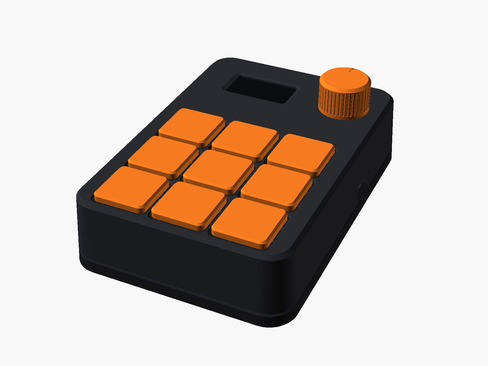
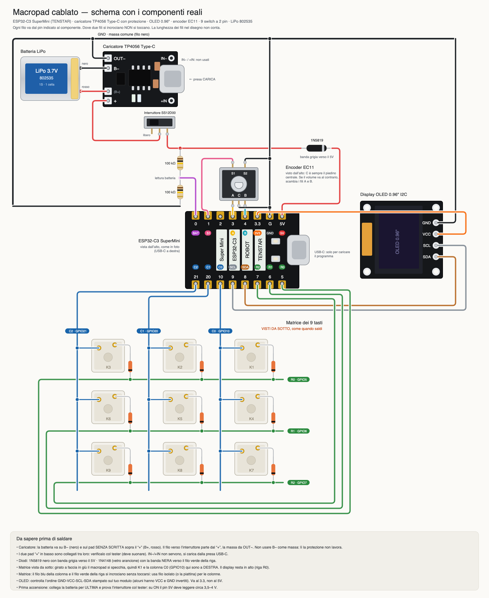

<div align="center">

# Macropad C3

**Nove tasti. Una manopola. Zero PCB.**

Macropad Bluetooth open source con 9 tasti meccanici, una manopola e un display OLED che mostra a cosa serve ogni tasto.
Si cabla a mano attorno a un ESP32-C3 SuperMini e si stampa senza supporti.

### [⚡ Programmalo dal browser](https://ziocola.github.io/macropad-c3/) · [🇬🇧 English](README.md)



</div>

## Caratteristiche

- **Tastiera Bluetooth LE** per macOS e Windows. Ogni tasto ha una combinazione per ciascun sistema; tieni premuta la manopola per passare dall'uno all'altro.
- **Etichette sul display:** l'OLED mostra il nome della pagina e le 9 etichette, e illumina il tasto premuto.
- **Fino a 8 pagine**, ognuna con la sua funzione per la manopola: volume, scorrimento, schede, zoom o qualsiasi scorciatoia. Una pressione breve della manopola passa alla pagina dopo.
- **A batteria**: LiPo da 700 mAh, ricarica USB-C, interruttore, livello della batteria sul display. Il display si spegne dopo 1 minuto e l'ESP32 dopo 15; la manopola lo risveglia.
- **Cablato a mano**: moduli già pronti e componenti a foro passante, niente PCB.
- **Guscio robusto**: viti M3 in inserti filettati in ottone, nessun supporto di stampa.

## Programmare la scheda

Il modo più semplice è la **[pagina di programmazione](https://ziocola.github.io/macropad-c3/)**. Serve Chrome o Edge su un computer.

1. Collega l'ESP32-C3 SuperMini con un cavo USB-C **dati**.
2. Clicca **Installa Macropad C3**, scegli la porta (di solito *USB JTAG/serial debug unit*) e conferma.
3. Dopo circa 30 secondi la scheda si riavvia. Abbina **Macropad C3** dalle impostazioni Bluetooth.

Se la scheda non viene trovata: tieni premuto **BOOT**, premi e rilascia **RESET**, rilascia BOOT e riprova.

<details>
<summary>Compilarlo da soli con PlatformIO</summary>

```bash
cd firmware
pio run -t upload        # compila e carica
pio device monitor       # vedi i tasti premuti (115200 baud)
```

A ogni push su `main`, GitHub Actions compila il firmware e lo pubblica sulla pagina di programmazione. Con un tag di versione (`v1.2`) allega anche `-full.bin` (da caricare a `0x0`) e `-app.bin` (da caricare a `0x10000`) a una release.
</details>

## Componenti

| Pezzo | Q.tà |
|---|---|
| ESP32-C3 SuperMini | 1 |
| Caricatore TP4056 USB-C con protezione (14 × 18 mm) | 1 |
| LiPo 802535, 700 mAh | 1 |
| OLED I2C 0,96" 128×64 (GND VCC SCL SDA) | 1 |
| Encoder EC11 con pulsante, albero zigrinato 6 mm accorciato a 12,5 mm | 1 |
| Switch MX a 2 pin (es. Kailh Box Brown) | 9 |
| Diodi 1N4148 | 9 |
| Diodo Schottky 1N5819 | 1 |
| Resistenze 100 kΩ | 2 |
| Interruttore a slitta SS12D00 | 1 |
| Inserti M3 a caldo, lunghi 5,7 mm, Ø esterno 4,6 | 4 |
| Viti M3 × 12 svasate | 4 |
| Viti M2 × 6 autofilettanti (barretta del display) | 2 |
| Piedini in silicone Ø 10 mm | 4 |
| Filo 28 AWG, guaina termorestringente | — |

## Collegamenti



| Funzione | GPIO |
|---|---|
| Righe R0 · R1 · R2 | 5 · 6 · 7 |
| Colonne C0 · C1 · C2 | 10 · 20 · 21 |
| OLED SDA · SCL (VCC → 3.3, GND → G) | 8 · 9 |
| Encoder A · B · pulsante (comune e S2 → GND) | 3 · 4 · 1 |
| Lettura batteria, partitore 100k + 100k | 0 |

- **Matrice:** colonna → switch → 1N4148 → riga, con la fascetta del diodo verso la riga. R0 è la fila vicino al display, C0 la colonna di sinistra vista dall'alto.
- **Alimentazione:** batteria su B+/B− del TP4056. Poi OUT+ → interruttore → 1N5819 (fascetta verso la scheda) → **5V**, e OUT− → **G**. Non usare B− come massa.

## Stampa 3D

I file sono in `hardware/stl/`.

| File | Colore | Note |
|---|---|---|
| `macropad_top_shell.stl` | nero | capovolto, senza supporti |
| `macropad_bottom.stl` | nero | logo verso il piatto |
| `keycaps_x9.stl`, `knob.stl` | arancione | faccia superiore sul piatto |
| `oled_clamp.stl` | nero | |
| `test/*.stl` | qualsiasi | prove di incastro, da stampare per prime |

[`hardware/bambu/Macropad_C3_A1.3mf`](hardware/bambu/Macropad_C3_A1.3mf) è il progetto Bambu Studio pronto per la A1 con ugello 0,4. Ha 4 piatti: PLA, strato 0,20 mm, 3 pareti, gyroid 15%.

**Inserti:** spingi i quattro inserti M3 nelle torrette del guscio con il saldatore a 220–230 °C finché sono a filo. Poi chiudi dal basso con viti M3 × 12 svasate. Prima stampa `test_insert.stl` per scegliere il foro.

## Personalizzare i tasti

| | Funziona su | Come |
|---|---|---|
| **[Configuratore web](https://ziocola.github.io/macropad-c3/configurator.html)** | Windows, macOS, Linux (Chrome o Edge) | Cavo USB, oppure Bluetooth dove il browser vede il macropad |
| **[Macropad Config per Mac](https://github.com/Ziocola/macropad-c3/releases/latest/download/Macropad-Config-macOS.zip)** | macOS 14 o successivo, Apple silicon e Intel | Bluetooth |

Entrambi modificano la stessa configurazione, salvata sul macropad. L'app per Mac non è autenticata da Apple. La prima volta che la apri, vai in *Impostazioni di Sistema → Privacy e sicurezza* e clicca **Apri comunque**. Se macOS la blocca ancora, esegui `xattr -dr com.apple.quarantine "/Applications/Macropad Config.app"`.

- **Nel firmware:** le pagine predefinite sono in [`firmware/src/keymap.h`](firmware/src/keymap.h).
- **Protocollo:** il firmware riceve la configurazione completa in JSON via Bluetooth, oppure come righe di testo via USB, e la salva in memoria. Il protocollo è descritto in [`app_link.h`](firmware/src/app_link.h) e il formato in [`store.cpp`](firmware/src/store.cpp). C'è un esempio con una pagina per Autodesk Fusion in [`docs/example_config_fusion.json`](docs/example_config_fusion.json).
- **Sorgenti dell'app per Mac:** in [`app/`](app). Si compila con `./build_app.sh`, oppure con `./package_release.sh` per lo zip universale (serve Xcode).

## Licenza

- Codice (`firmware/`, `app/`, `web/`): [MIT](LICENSE)
- Hardware (`hardware/`, `docs/`): [CC BY-NC-SA 4.0](hardware/LICENSE.md)

Design: Andrea3DLab
