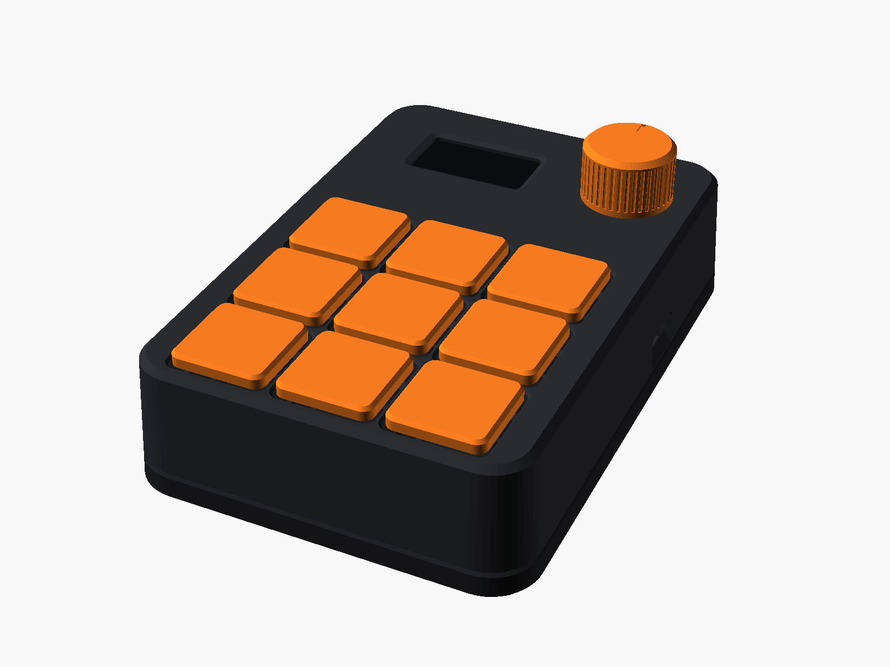
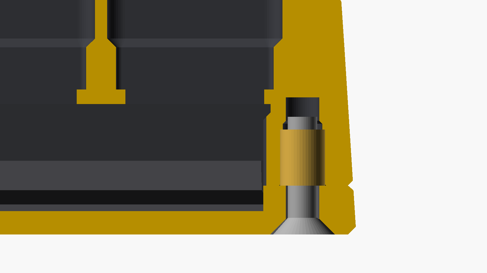

<div align="center">

# Macropad C3

**Nine keys. One knob. Zero PCBs.**

An open-source Bluetooth macropad with 9 mechanical keys, a rotary knob and an OLED that labels every key.
You hand-wire it around an ESP32-C3 SuperMini and print it on any FDM printer.

[](https://github.com/Ziocola/macropad-c3/actions/workflows/firmware-and-site.yml)
[](LICENSE)
[](hardware/LICENSE.md)

### [⚡ Flash it from your browser](https://ziocola.github.io/macropad-c3/) · [🇮🇹 Italiano](README.it.md)



</div>

## Features

- **Bluetooth LE keyboard** for macOS and Windows. Each key has its own combo for each OS; hold the knob to switch between them.
- **OLED labels.** The display shows the page name and all 9 labels, and lights up the key you press.
- **Up to 8 pages.** Each page sets its own knob action: volume, scrolling, tabs, zoom or any shortcut. A short press on the knob moves to the next page.
- **Battery powered**: 700 mAh LiPo, USB-C charging, power switch, battery level on screen. The display sleeps after 1 minute and the ESP32 after 15; the knob wakes it.
- **Hand-wired**: off-the-shelf modules and through-hole parts, no PCB.
- **Solid case**: M3 screws into brass heat-set inserts. Only the top shell needs supports.

## Flash the firmware

The quickest way is the **[web flasher](https://ziocola.github.io/macropad-c3/)**, which needs Chrome or Edge on a computer:

1. Plug the ESP32-C3 SuperMini in with a USB-C **data** cable.
2. Click **Install Macropad C3**, choose the port (usually *USB JTAG/serial debug unit*) and confirm.
3. After about 30 seconds the board restarts. Pair **Macropad C3** in your Bluetooth settings.

If the board isn't found, hold **BOOT**, tap **RESET**, release BOOT and try again.

<details>
<summary>Build it yourself with PlatformIO</summary>

```bash
cd firmware
pio run -t upload        # build and flash
pio device monitor       # see key presses (115200 baud)
```

Every push to `main` builds the firmware with GitHub Actions and publishes it to the web flasher. Tagging a version (`v1.2`) also attaches `-full.bin` (flash at `0x0`) and `-app.bin` (flash at `0x10000`) to a release.
</details>

## Parts

| Part | Qty | AliExpress | Variant to choose |
|---|---|---|---|
| ESP32-C3 SuperMini | 1 | [link](https://www.aliexpress.com/item/1005005967641936.html) | TENSTAR |
| TP4056 USB-C charger with protection, mini 14 × 18 mm | 1 | [link](https://www.aliexpress.com/item/1005009186628976.html) | Type-C · check it's the small 14 × 18 mm board |
| LiPo 802535, 700 mAh | 1 | [link](https://www.aliexpress.com/item/1005013535446410.html) | 1PCS |
| 0.96" I2C OLED 128×64, 4 pins | 1 | [link](https://www.aliexpress.com/item/1005004421432934.html) | LCD · pin order must be GND VCC SCL SDA |
| EC11 encoder with push button | 1 | [link](https://www.aliexpress.com/item/1005004907970664.html) | **20mm Plum Handle** (knurled shaft, cut to 12.5 mm) |
| MX switches, 2 pins, Kailh Box Brown | 9 | [link](https://www.aliexpress.com/item/1005003436102892.html) | KBDiy · Brown · pack of 10 |
| 1N4148 and 1N5819 diodes | 9 + 1 | [link](https://www.aliexpress.com/item/1005012172771559.html) | "1N4148 100 pcs" **and** "1N5819 100 pcs" |
| 100 kΩ resistors, 1/4 W | 2 | [link](https://www.aliexpress.com/item/1005002489867848.html) | 100K |
| SS12D00 slide switch | 1 | [link](https://www.aliexpress.com/item/1005002156794748.html) | 10 pcs |
| M3 heat-set inserts, 5.7 mm long, 4.6 mm OD | 4 | [link](https://www.aliexpress.com/item/1005004185759697.html) | M3 × 5.7 × 4.6 |
| M3 × 12 countersunk screws | 4 | [link](https://www.aliexpress.com/item/32968097507.html) | M3 · 12 mm |
| M2 × 6 self-tapping screws (display clamp) | 2 | [link](https://www.aliexpress.com/item/1005006739652380.html) | M2 |
| Silicone feet, Ø 10 mm | 4 | [link](https://www.aliexpress.com/item/32845551931.html) | 10 × 3 mm |
| 28 AWG silicone wire | — | [link](https://www.aliexpress.com/item/1005005450660428.html) | 28AWG |
| Heat-shrink tubing | — | [link](https://www.aliexpress.com/item/1005010534247083.html) | kit |

Listings change often: check the variant and the photos before you order. Wire, heat-shrink and screws are often already in the drawer.

## Wiring


| Function | GPIO |
|---|---|
| Key rows R0 · R1 · R2 | 5 · 6 · 7 |
| Key columns C0 · C1 · C2 | 10 · 20 · 21 |
| OLED SDA · SCL (VCC → 3.3, GND → G) | 8 · 9 |
| Encoder A · B · push (common and S2 → GND) | 3 · 4 · 1 |
| Battery sense, 100k + 100k divider | 0 |

- **Matrix:** column → switch → 1N4148 → row, with the diode's band towards the row. R0 is the row next to the display, C0 is the left column seen from above.
- **Power:** battery to TP4056 B+/B−. Then OUT+ → slide switch → 1N5819 (band towards the board) → **5V**, and OUT− → **G**. Don't use B− as ground.

A vector version is in [`docs/images/wiring.svg`](docs/images/wiring.svg).

## 3D printing

| File | Colour | Notes |
|---|---|---|
| `hardware/stl/macropad_top_shell.stl` | black | upside down, **tree supports (auto)** |
| `hardware/stl/macropad_bottom.stl` | black | logo towards the plate |
| `hardware/stl/keycaps_x9.stl`, `knob.stl` | orange | top face on the plate |
| `hardware/stl/oled_clamp.stl` | black | |
| `hardware/stl/test/*.stl` | any | fit tests, print these first |

[`hardware/bambu/Macropad_C3_A1.3mf`](hardware/bambu/Macropad_C3_A1.3mf) is a ready-made Bambu Studio project for the A1 with a 0.4 mm nozzle. It has 4 plates and uses PLA, 0.20 mm layers, 3 walls and 15% gyroid infill, with tree supports on the top shell only.

**Fit tests:** `test_switch`, `test_keycap`, `test_oled`, `test_knob` and `test_insert` are marked with 1–4 dots. Pick the size that fits best on your printer and set it in [`hardware/case/macropad_c3.scad`](hardware/case/macropad_c3.scad), which is fully parametric (OpenSCAD).

**Inserts:** press the four M3 inserts into the shell bosses with a soldering iron at 220–230 °C until they are flush. Then close the case from below with M3 × 12 countersunk screws.



## Customise the keys

| | Works on | How |
|---|---|---|
| **[Web configurator](https://ziocola.github.io/macropad-c3/configurator.html)** | Windows, macOS, Linux (Chrome or Edge) | USB cable, or Bluetooth where the browser can see the macropad |
| **[Macropad Config for Mac](https://github.com/Ziocola/macropad-c3/releases/latest/download/Macropad-Config-macOS.zip)** | macOS 14+, Apple silicon and Intel | Bluetooth |

Both edit the same layout, which is stored on the macropad. The Mac app isn't notarized. The first time you open it, go to *System Settings → Privacy & Security* and click **Open Anyway**. If macOS still refuses, run `xattr -dr com.apple.quarantine "/Applications/Macropad Config.app"`.

- **In the firmware:** the default pages are in [`firmware/src/keymap.h`](firmware/src/keymap.h). Write one line per key, for example `KEY("Copy", PRI, K_C)`, where `PRI` is Cmd on Mac and Ctrl on Windows.
- **Protocol:** the firmware accepts the whole layout as JSON over BLE, or as text lines over USB, and stores it in flash. See [`app_link.h`](firmware/src/app_link.h) for the protocol and [`store.cpp`](firmware/src/store.cpp) for the format. [`docs/example_config_fusion.json`](docs/example_config_fusion.json) is an example with an Autodesk Fusion page.
- **Mac app source:** [`app/`](app). Build it with `./build_app.sh`, or run `./package_release.sh` for the universal zip (Xcode required).

## Repository layout

```
firmware/   PlatformIO project (Arduino core, NimBLE, U8g2, ArduinoJson)
app/        macOS configuration app (SwiftUI)
hardware/   OpenSCAD source, STL files, Bambu Studio project
web/        website and web flasher (published to GitHub Pages)
docs/       wiring diagram, renders, example configuration
```

## License

- Code (`firmware/`, `app/`, `web/`): [MIT](LICENSE)
- Hardware (`hardware/`, `docs/`): [CC BY-NC-SA 4.0](hardware/LICENSE.md)

Design: Andrea3DLab
